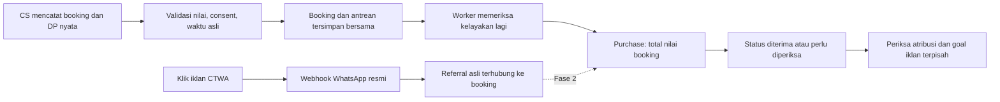

# Trigger CAPI dan report Labbaika

## Yang terlihat pada produk referensi

[Landing page Trigger CAPI](https://widyaherma.com/trigger-capi-lp) menawarkan halaman input closing: CS memilih produk, memasukkan kontak/nominal, lalu mengirim Purchase ke Meta. Halaman menyebut pencatatan spreadsheet, tampilan bermerek sendiri, paket file mandiri, pemasangan, dan beberapa brand. Bukti yang dipamerkan berfokus pada Purchase yang tampil di Events Manager; terdapat klaim perbaikan biaya closing dan kualitas leads dari pengalaman penjual. Itu klaim penjual, belum merupakan eksperimen independen.

[Onboarding pemasangan](https://widyaherma.com/trigger-capi-onboarding-dfy.html) meminta Pixel ID, kesiapan token CAPI, mata uang, daftar produk/harga, identitas brand, dan akun Cloudflare. Ini konsisten dengan alat input transaksi dan koneksi server ke Meta. Kode backend, endpoint produksi, skema payload, pengamanan token, deduplikasi dan pencocokan CTWA tidak terbuka dari materi tersebut. Karena itu, dukungan `ctwa_clid` atau optimasi CTWA tidak dapat dipastikan dari landing page.

Materi menampilkan Test Events/Processed sebagai bukti penerimaan. Penerimaan teknis harus dibedakan dari atribusi campaign dan penggunaan dalam optimasi. Angka jendela atribusi pada materi pemasaran juga harus diverifikasi terhadap setting/jalur aktual, bukan dijadikan batas universal.

Catatan sumber: snapshot HTML publik dibaca pada sesi analisis 6 Oktober 2026; pengambilan ulang via web tool 7 Oktober tidak tersedia. Fitur/penawaran bisa berubah. Tidak ada akses ke kode atau akun pelanggan vendor.

## Korelasi dengan codebase Labbaika

| Kebutuhan | Aset Labbaika yang sudah ada | Rancangan integrasi |
|---|---|---|
| Data pelanggan saat closing | Form CS, WhatsApp, consent, program, pax, pembayaran | Pakai catatan yang sama; hindari form kedua yang harus diisi ulang |
| Daftar produk dan nilai | Master program/harga serta snapshot transaksi | Purchase memakai total nilai booking saat DP pertama |
| Catatan sumber transaksi | UUID closing, CS, brand, program | Event identity mengikuti booking kanonik |
| Pembukuan/report | Dashboard, riwayat, export | Tambahkan status pengiriman; kas dan booking value tetap dibedakan |
| Laporan iklan | Sinkronisasi statistik Meta yang masuk ke dashboard | Tambahkan aliran keluar hasil closing; sync statistik tidak otomatis berarti CAPI |
| Pengiriman andal | Belum ada CAPI pada baseline | Outbox atomik, worker server, batas percobaan dan penanganan hasil ambigu |
| Atribusi CTWA | Belum ada referral individual; laporan lead agregat | Fase2 butuh capture referral resmi dan hubungan conversation → booking |

Alur target Labbaika:

Inti produk yang dapat diadaptasi adalah pelaporan hasil penjualan manual. Keunggulan rancangan Labbaika berasal dari integrasi langsung dengan booking, snapshot harga, pemisahan akses, dan antrean yang dapat diperiksa. Klaim peningkatan performa iklan tetap membutuhkan pembuktian pada akun sendiri. Pembangunan ini tidak menyalin source code vendor atau membeli layanannya.

## Pembaruan 4 November 2026 — Gass sebagai pembanding kedua

Dibaca dari [docs.gass.co.id](https://docs.gass.co.id/) (halaman Orders, Coexistence, format teks CS, Unknown vs Unattributed, beda angka Gass vs Meta). Hanya gambaran; **rencana Labbaika tidak berubah**.

- Gass menangkap Purchase dari **pesan berformat yang diketik CS di chat WhatsApp** ("Format Purchase" + `Total : %VALUE%`), jadi event tercatat saat closing terjadi, bukan diunggah belakangan. Ada juga "Format Prospect" untuk event tengah corong.
- Data sampai campaign/adset/ad didapat karena nomor CS tersambung lewat **WhatsApp Coexistence** (resmi). Koneksi tidak resmi (KonekWA) menghasilkan "Unknown" tanpa detail iklan. Ini setara rencana Fase 2 Labbaika (H04/W01–W06), bukan Fase 1.
- Trigger CAPI menyatakan sendiri bahwa siklus jualan lebih dari 7 hari tidak tercatat sebagai hasil campaign dan bahwa alatnya bergantung pada disiplin CS mengisi tiap closing. Kesimpulan yang sama berlaku untuk Fase 1 Labbaika: nilai CAPI ditentukan kecepatan input CS (target ≤ H+1/H+2 dari DP).

Implikasi yang dicatat sebagai backlog (lihat `CAPI-TASKS.md` O06, M04):
- Monitor jeda input (waktu DP → waktu closing diinput) per CS.
- Untuk siklus umrah yang panjang, event lebih awal (konsultasi/penawaran) yang terjadi dalam 7 hari setelah klik lebih berguna untuk optimasi daripada Purchase saja. Butuh data lead individual, jadi bergantung Fase 2.
- **Risiko Purchase ganda:** dashboard punya "Export Gass Apps". Bila data itu dimasukkan ke alat lain yang juga mengirim Purchase ke Meta, CAPI Labbaika tidak boleh diaktifkan untuk booking yang sama tanpa skema dedup bersama.
